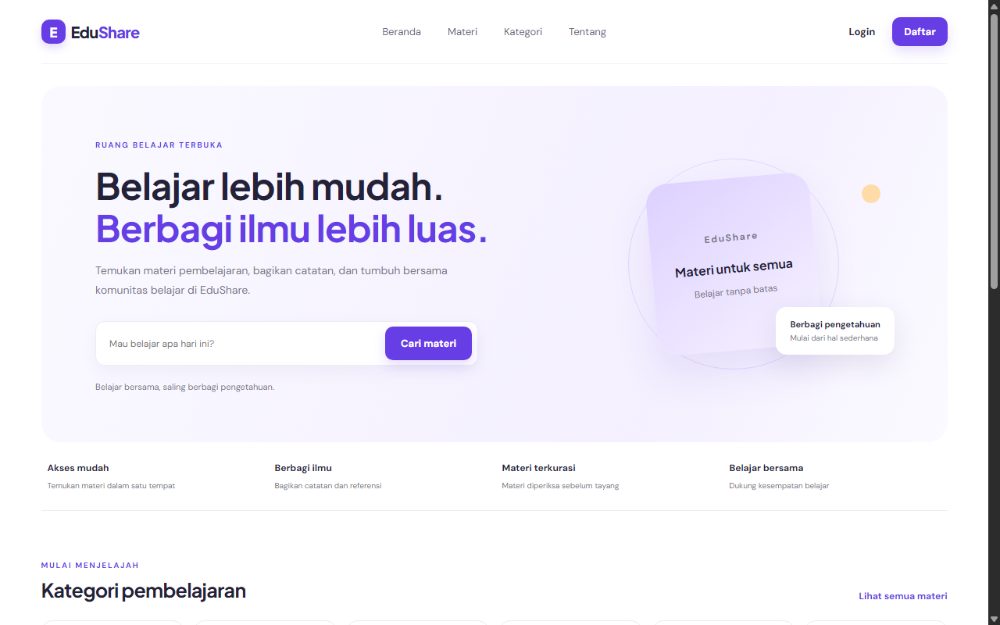
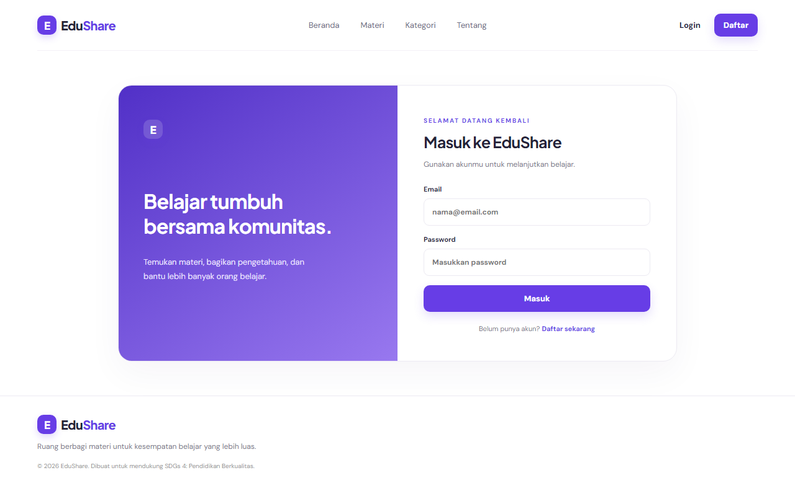
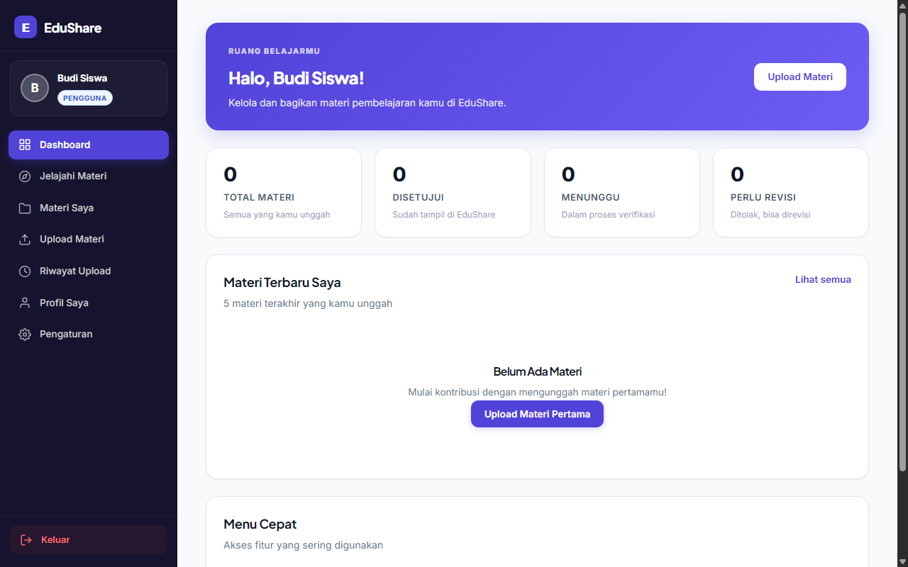
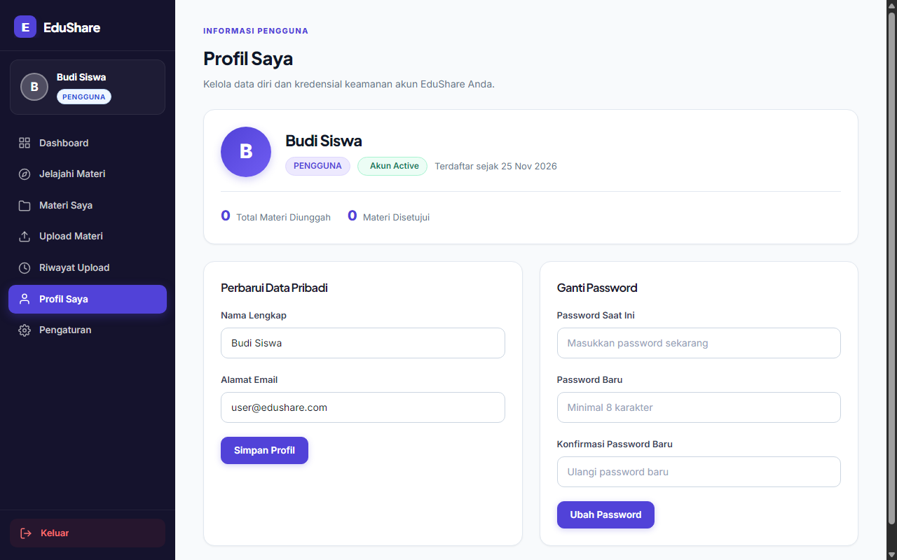
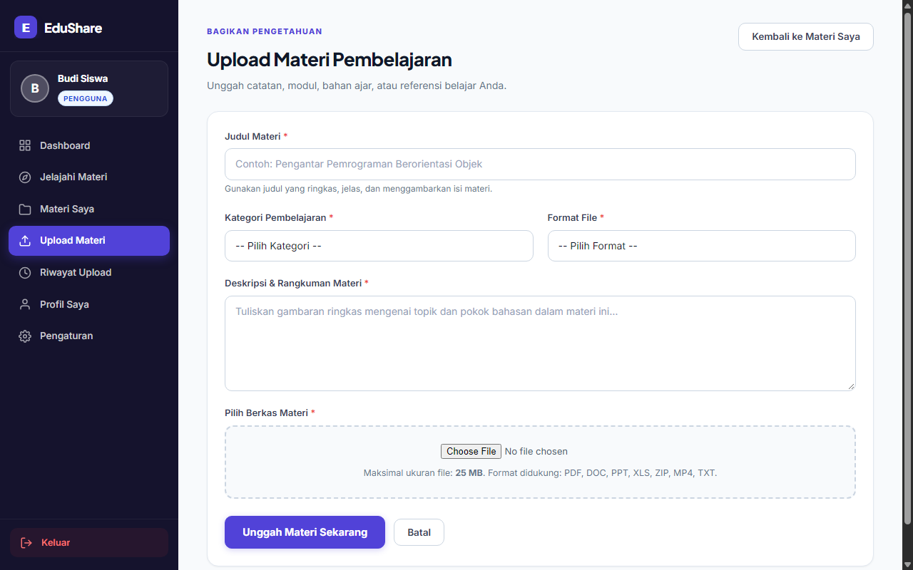
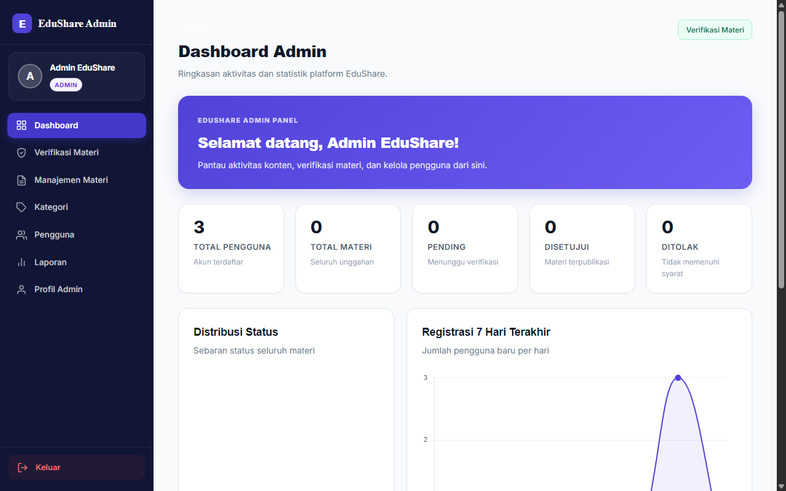
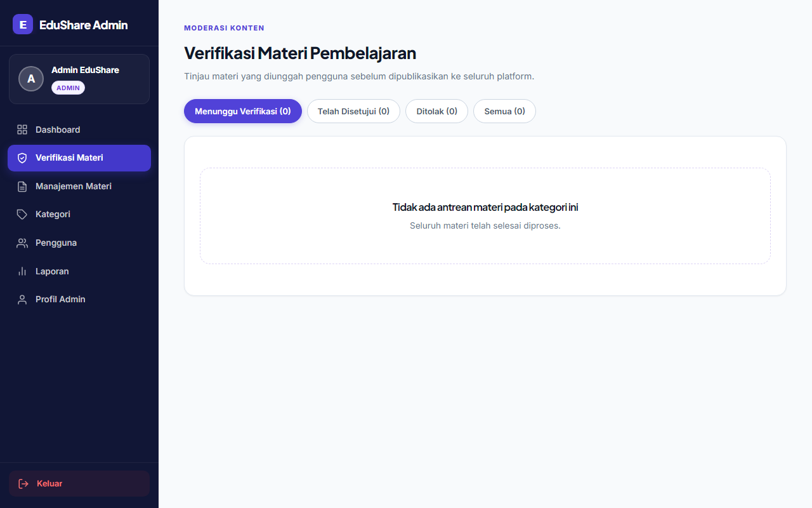
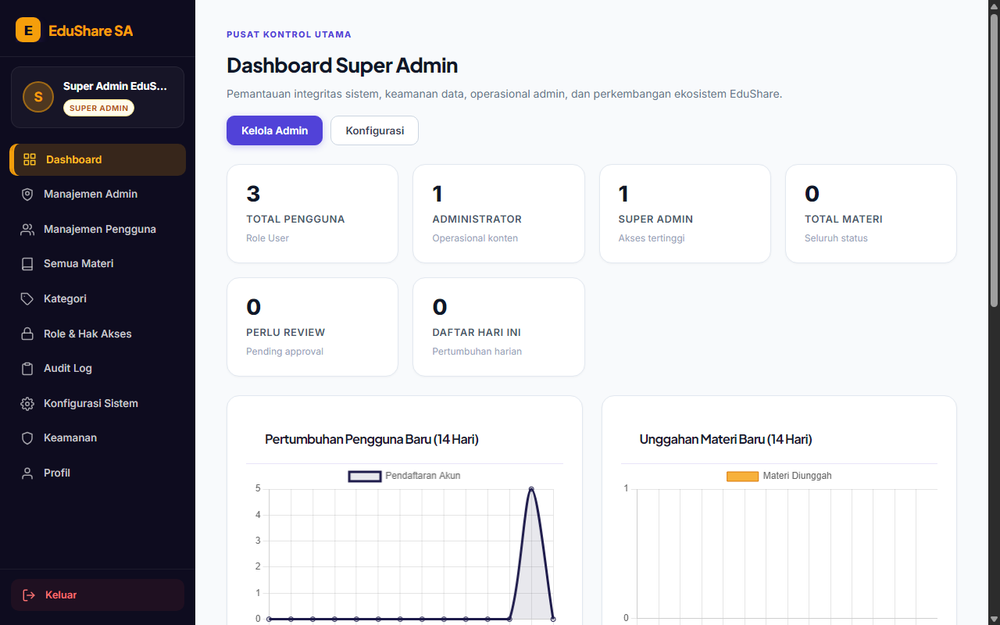
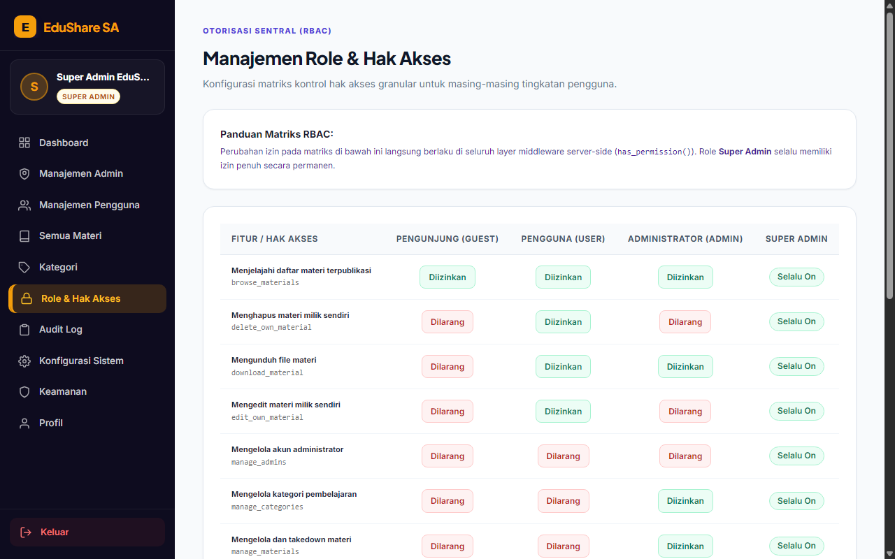
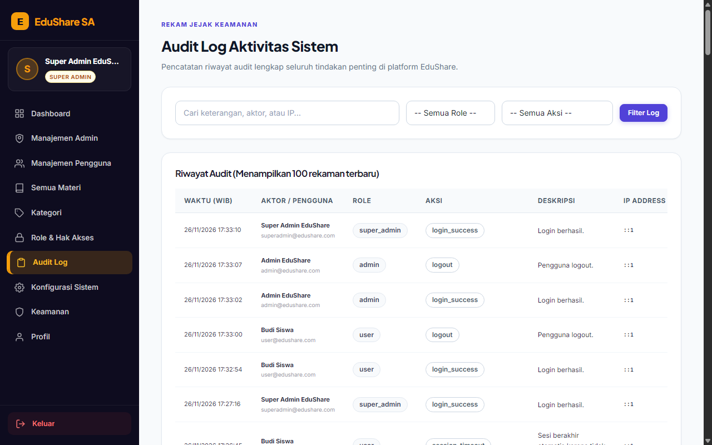

# EduShare — Highlight Fitur Unggulan & Galeri Tampilan Aplikasi

EduShare adalah platform pembelajaran dan berbagi materi berbasis web yang dilengkapi dengan sistem **Role-Based Access Control (RBAC)** empat tingkatan, pemisahan layout dan visual dashboard secara menyeluruh, serta arsitektur keamanan terstandarisasi.

---

## 1. Highlight Fitur & Modul Unggulan

Platform EduShare memiliki 4 pengalaman pengguna independen yang disesuaikan dengan peran pengguna:

### A. Modul Pengunjung & Publik (Guest Experience)
1. **Landing Page Modern & Ruang Belajar Terbuka**:
   - Menampilkan materi terpopuler dan terverifikasi secara dinamis dari database.
   - Penjelajahan berbasis kategori kurasi (Sains, Teknologi, Bahasa, Bisnis, Desain, Matematika).
   - Pencarian instan berdasarkan judul, deskripsi, dan kategori.
2. **Detail Materi & Kebijakan Hak Akses**:
   - Pratinjau metadata lengkap: pengunggah, tanggal, ukuran file, jumlah unduhan, dan deskripsi materi.
   - Proteksi unduhan terintegrasi: pengguna tamu diarahkan untuk melakukan autentikasi sebelum dapat mengunduh berkas fisik.

### B. Modul Pembelajaran Pengguna (User Dashboard)
1. **Personal Learning Hub (`user/dashboard.php`)**:
   - Kartu metrik KPI dinamis: Total materi diunggah, materi disetujui, menunggu verifikasi, dan perlu revisi.
   - Tabel riwayat unggahan terbaru dan menu jalan pintas cepat (*Quick Action*).
2. **Koleksi & Manajemen Materi Mandiri (`user/materi_saya.php`)**:
   - Filter tab real-time berdasarkan status (*Semua, Disetujui, Menunggu, Ditolak*).
   - Menampilkan catatan penolakan (*rejection note*) transparan dari admin jika materi memerlukan revisi.
3. **Formulir Pengunggahan Materi (`user/upload.php`)**:
   - Validasi MIME type berkas ketat di sisi server (PDF, DOC/DOCX, PPT/PPTX, XLS/XLSX, ZIP, MP4, TXT) dengan pembatasan ukuran hingga 25 MB.
4. **Pusat Pengaturan & Profil (`user/profil.php` & `user/pengaturan.php`)**:
   - Pembaruan nama dan email dengan validasi keunikan database.
   - Mekanisme ganti password dengan verifikasi password lama (`password_verify`) dan hashing `PASSWORD_DEFAULT`.

### C. Modul Operasional Konten & Moderasi (Admin Dashboard)
1. **Pusat Kendali Operasional (`admin/dashboard.php`)**:
   - Ringkasan statistik ekosistem: total pengguna terdaftar, total materi, materi pending, disetujui, dan ditolak.
   - Grafik analitik interaktif: distribusi status materi dan tren registrasi pengguna 7 hari terakhir.
2. **Antrean Moderasi & Verifikasi Materi (`admin/verifikasi.php`)**:
   - Aksi sekali klik untuk menyetujui materi publik.
   - Modal konfirmasi penolakan materi dengan kewajiban mengisi alasan penolakan (*rejection reason*).
3. **Manajemen Konten & Kategori (`admin/materi.php` & `admin/kategori.php`)**:
   - Manajemen katalog kategori pembelajaran (tambah, edit status aktif/nonaktif).
   - Pemantauan seluruh materi dengan opsi pencabutan publikasi materi yang melanggar ketentuan.
4. **Manajemen Pengguna Terbatas (`admin/pengguna.php`)**:
   - Memantau pengguna biasa (Role: User), tanpa hak untuk mengedit atau menghapus akun administrator maupun super admin.

### D. Modul Tata Kelola Tertinggi (Super Admin Control Center)
1. **Master Control Dashboard (`superadmin/dashboard.php`)**:
   - Pemantauan menyeluruh seluruh akun, materi, dan integritas sistem.
   - Notifikasi antrean moderasi dan analitik aktivitas platform.
2. **Manajemen Administrator & Akun Khusus (`superadmin/admins.php`)**:
   - Pembuatan akun administrator baru melalui mekanisme otentikasi internal yang aman (tidak melalui registrasi publik).
   - Pengaktifan, penonaktifan, atau penangguhan akun administrator.
3. **Matriks Role-Based Access Control (`superadmin/roles.php`)**:
   - Konfigurasi izin dinamis per peran pengguna yang tersimpan di tabel `role_permissions`.
4. **Audit Log & Keamanan Sistem (`superadmin/audit.php` & `superadmin/keamanan.php`)**:
   - Pencatatan otomatis setiap aksi krusial (login, verifikasi, perubahan konfigurasi, manajemen user) lengkap dengan actor ID, alamat IP, metadata JSON, dan timestamp.
   - Reset sesi global, proteksi session fixation, dan pelacakan anomali keamanan.

---

## 2. Galeri Tangkapan Layar Tampilan Aplikasi

Berikut adalah dokumentasi visual tampilan antarmuka EduShare di berbagai modul dan peran:

### 1. Halaman Publik & Autentikasi
````carousel

<!-- slide -->

````

### 2. Dashboard Pengguna (User)
````carousel

<!-- slide -->

<!-- slide -->

````

### 3. Dashboard Administrator (Admin)
````carousel

<!-- slide -->

````

### 4. Dashboard Super Administrator (Super Admin)
````carousel

<!-- slide -->

<!-- slide -->

````

---

## 3. Matriks Kredensial Pengujian Terverifikasi

Seluruh akun di bawah ini telah terverifikasi aktif pada database MySQL dan siap digunakan untuk uji coba:

| Peran | Email | Password | URL Halaman Utama |
|---|---|---|---|
| **Super Admin** | `superadmin@edushare.com` | `admin123` | [superadmin/dashboard.php](http://localhost/edushare/superadmin/dashboard.php) |
| **Admin** | `admin@edushare.com` | `admin123` | [admin/dashboard.php](http://localhost/edushare/admin/dashboard.php) |
| **User (Pengguna)** | `user@edushare.com` | `admin123` | [user/dashboard.php](http://localhost/edushare/user/dashboard.php) |
| **Guest (Tamu)** | *(Tanpa login)* | *(Tanpa login)* | [index.php](http://localhost/edushare/index.php) |
